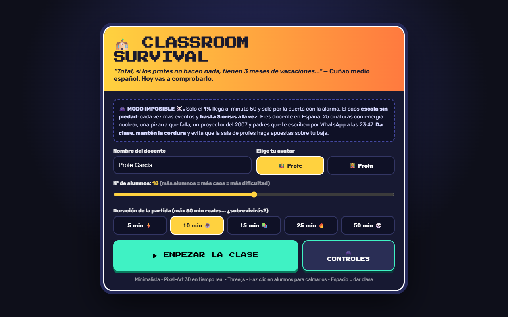
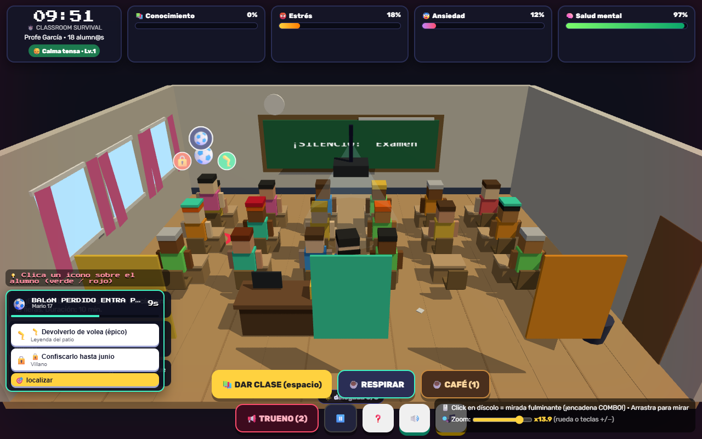

# 🏫 CLASSROOM SURVIVAL

> *"Total, si los profes no hacen nada, tienen 3 meses de vacaciones..."* — Cuñao medio español. Hoy vas a comprobarlo.

Minijuego 3D en tono de humor sobre la vida docente en España: eres profesor o profesora en un aula llena de fieras y tienes que **sobrevivir a la clase sin que tu salud mental llegue a cero**.

🎮 **Juégalo ahora en tu navegador:** https://ray86-dev.github.io/classroom-survival/

Sin instalación, sin registro. Solo necesitas internet la primera vez (Three.js se carga desde CDN).





## 🎯 Objetivo

* **Da clase** para subir el **📚 Conocimiento** del alumnado.
* Aguanta la **duración elegida** (5–50 min) sin que te tumben:
  * 😡 **Estrés** al 100% → baja laboral.
  * 😰 **Ansiedad** al 100% → ataque de ansiedad.
  * 🧠 **Salud mental** a 0 → burnout.
* **MODO IMPOSIBLE ☠️:** el caos escala con el tiempo — los eventos llegan cada vez más rápido y **hasta 3 crisis a la vez**. Solo el **1%** llega al minuto 50, suena la alarma y sale por la puerta entre aplausos.

## 🕹️ Cómo se juega

* **Clica los iconos sobre cada alumno** (🟩 opción A / 🟥 opción B) para resolver su crisis sin abrir menús. El icono central muestra el evento y se pone 🟡/🔴 cuando se agota el tiempo.
* **Click en un alumno díscolo** = 👀 mirada fulminante. Encadena miradas en menos de 3,5 s para subir el **COMBO x2…x9** (¡pero no mires a un inocente o romperás el combo!).
* **ESPACIO o 📚 DAR CLASE** para explicar (rinde menos con el aula patas arriba).
* **Arrastra** para mirar alrededor, **rueda / slider / teclas +/−** para zoom.
* El dock inferior-izquierdo resume cada crisis por si prefieres leer la descripción antes de decidir.

### Eventos disruptivos (humor español)

Estornudos sónicos, llantos por una goma con forma de unicornio, el de *"¿puedo ir al baño?"* por 12ª vez (se levanta y **camina hasta la puerta** a esperar tu permiso), guerras de bolas de papel que **ensucian el suelo de verdad**, chicles globo, vómitos históricos con charco persistente, desmayos, tinta líquida explosiva, toques en la puerta (el visitante **entra caminando**), móviles con reggaetón, padres a recoger con excusa del dentista, el jefe de estudios interrumpiendo, balones que **entran volando por la ventana** con las cortinas ondeando, bocadillos clandestinos, el alumno youtuber ("¡saluda a mi canal!") y la inspección sorpresa.

### Poderes tácticos (teclas 1 y 2)

* ☕ **Café de sala de profes** — ansiedad −35 de golpe, pero 30 s de tembleque enseñando peor.
* 📢 **Voz de trueno** — 10 s de silencio total... seguidos de 20 s de rebote de caos x2.

### El alumnado tiene memoria

* 😈 **Repetidor** (gorra roja): lía 3 veces más.
* 🌟 **Delegada** (insignia): trátala bien y con confianza 3+ calmará ella sola una crisis cada 25 s.
* 💙 **Alumnado NEAE**: atiéndelo como merece y el aula rinde un 10 % mejor.

## 💻 Jugar en local

```bash
git clone https://github.com/Ray86-dev/classroom-survival.git
cd classroom-survival
npx serve .
```

Y abre http://localhost:3000 (o cualquier servidor estático).

## 🛠️ Tecnologías

* Un solo `index.html` (~78 KB de JS), sin build ni dependencias instaladas.
* Render 3D minimalista pixel-art en tiempo real con **Three.js** (importado por CDN como ES module).
* Sonido y música chiptune 100 % **Web Audio API** procedural: 14 efectos + banda sonora que se tensa con tu estrés. Sin ficheros de audio.
* Estado, físicas de juguetes (papeles, balones, confeti) y escalado de dificultad, todo en vanilla JS.

## ⚠️ Nota

Juego satírico hecho con cariño hacia el profesorado. Cualquier parecido con tu clase de 6ºB es pura coincidencia... o no.
